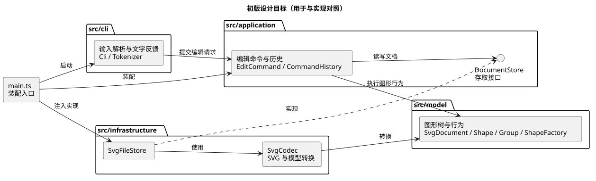
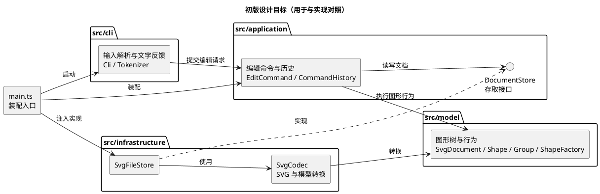
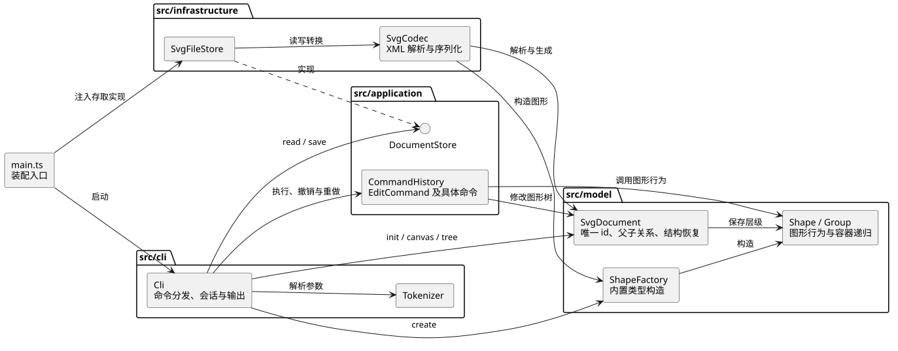
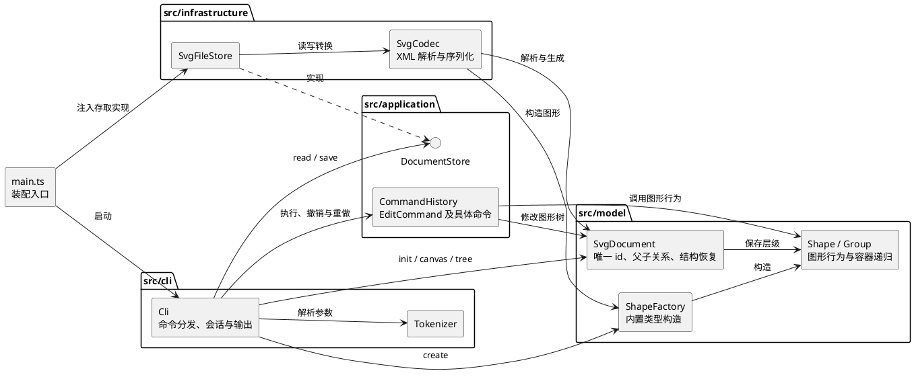

# SVG 编辑器 Phase 1：设计与过程记录

> 本文保留第一轮的设计假设，并记录每轮实现与最终核查。初版架构图用于对照演化过程；实际依赖见文末“一致性自查”。

## 架构方案

### 模块划分

| 目录 | 职责 |
| --- | --- |
| `src/model/` | SVG 文档、图形类与容器树；维护唯一 id、父子关系及图形自身的移动、缩放、属性修改行为。 |
| `src/application/` | 编辑命令、执行与 undo/redo 历史；协调模型操作，并定义 SVG 存取所需的接口。 |
| `src/cli/` | REPL、带引号的参数解析、命令名分发和文字反馈；不直接修改图形内部状态。 |
| `src/infrastructure/` | SVG/XML 与模型的双向转换、文件读写；实现应用层定义的存取接口。 |
| `src/main.ts` | 创建并连接上述对象，启动 CLI。 |

下面是初版**设计目标**的组件图：框内标出每层的关键职责和接口，箭头表示预期依赖方向。**这不是最终实现图**；实际依赖图见“一致性自查”。题目要求组件图或包图，因此这里按职责成组表达，不逐个罗列全部具体图形类和命令类。

对应的 PlantUML 源码：

### 设计模式的选择

- **Command（题目要求）**：每个成功的图形编辑操作是一个命令对象，负责执行并保存撤销所需的信息；执行器维护 undo/redo 栈。一条命令对应一个撤销单元，失败命令不入栈。删除、分组和层级调整需要保存原父容器与原位置，不能只保存图形 id。
- 其中 `Cli` 把输入转换为命令请求，`CommandHistory` 是执行与历史管理者，各个 `EditCommand` 是命令对象，`Shape` / `SvgDocument` 是实际执行业务行为的接收者。`move`、`scale`、`set` 共用 `ShapeEditCommand`：回调选择接收者的方法，命令对象统一保存编辑前状态并负责撤销。这样保留了 Command 的执行与撤销边界，同时避免为三个相同生命周期的动作重复建类。
- **Composite 语义**：叶子图形与 `<g>` 容器共享图形抽象。容器把移动、缩放等操作应用到子孙；调用方不按图形类型重复写分支。模型的公开行为由对象自身负责，避免公共数据袋。
- 本阶段暂不建立通用插件框架。题目中的 `box` 是后续阶段目标，Phase 1 的内置类型只有 `rect`、`circle`、`ellipse`、`line`、`text`、`g`。

### 依赖方向规则

1. `model` 不依赖 CLI、文件系统或应用层；图形行为可以脱离终端测试。
2. `application` 依赖 `model`，通过自己定义的存取接口访问 SVG 文件；不直接依赖具体 XML 库或 Node 文件 API。
3. `cli` 依赖 `application`；`infrastructure` 实现应用层接口并依赖 `model`；只有 `main.ts` 负责装配具体实现。
4. 按名称选择实现只出现在命令分发和图形工厂两处。这两处先集中管理并标为后续重构点，不让 `switch(tag)` 扩散到编辑操作中。

### 变化点假设

| 可能的变化 | 本阶段的处理 |
| --- | --- |
| 新增图形类型 | 图形行为由类封装，类型名到构造器的选择集中在图形工厂；等后续阶段明确插件要求再改为注册机制。 |
| 新增命令或入口 | 编辑动作与 CLI 输入分离；新入口可复用应用层。命令名分发集中在 CLI。 |
| 图形组织方式变化 | 以容器树表达层级，按 id 定位由文档统一负责；不把层级路径写进命令参数。 |
| SVG 读写细节变化 | 限制在 `infrastructure`，模型不直接处理 XML 或文件路径。 |

## 过程记录

### 迭代 1：先明确边界

- 根据题目和课程课件，先将 CLI、命令执行、图形模型、SVG 读写分开，并确定 Command 与 Composite 的落点。
- 选择保存每条命令需要的旧值、原父容器和原位置，以支持精确撤销；暂不为后续 `box` 实现插件框架，避免在需求明确前增加复杂度。
- 此时尚未编写功能代码，以上为待验证的设计假设。后续提交会记录发现的问题和修订。

### 迭代 2：建立可运行的 CLI 骨架

- 建立 TypeScript 编译配置、项目脚本和 CLI 入口。CLI 目前只负责逐行读取、显示提示符、忽略空行与注释；图形模型和命令执行尚未开始实现。
- 输入输出通过构造参数传给 `Cli`，后续可以在不启动真实终端的情况下检查命令行为。此时不提前加入 XML 或插件依赖。
- 已运行 `npm run check`、`npm run build`，并用多行输入验证入口可启动、注释可忽略。尚未实现的命令会明确报错，不将骨架当作完成功能。

### 迭代 3：建立图形模型

- 新增六种内置图形、共同的 `Shape` 抽象、容器 `Group` 和 `SvgDocument`。图形各自负责自己的几何属性，容器递归执行移动与缩放。
- 当前文档按树遍历查找 id，不预先维护第二份索引。这样先保证唯一性和父子关系正确；若后续规模或需求需要，再将查找换成索引。
- 加入模型测试，覆盖六种图形的统一操作、嵌套容器、重复 id 拒绝和祖先循环防护。本轮 `npm test` 的四项测试均通过。

### 迭代 4：接通 CLI 与图形模型

- 在 CLI 增加带双引号参数的分词、`init/create/tree/show/help` 命令，并让 `create` 通过集中图形工厂构造六种内置图形。`in <容器 id>` 在创建时确定归属。
- 显示命令读取模型并输出结构与属性；创建失败时先验证参数和目标容器，不改变当前文档。命令名分发与图形类型分发仍集中在架构方案标出的两处。
- 管道输入测试发现读取结束后再次显示提示符会报错；增加关闭状态检查后修复。`npm test` 现有八项测试均通过。

### 迭代 5：基本编辑与撤销重做

- 引入 `CommandHistory` 管理 undo/redo 栈，成功执行的编辑命令才进入历史；undo 后的新编辑清空 redo。`init` 清空旧历史并禁止撤销，直到下一次成功编辑。
- `create`、`delete` 作为命令；`move`、`scale`、`set` 通过可撤销的图形编辑命令调用模型行为。删除保存子树、原父容器和原位置；几何与属性编辑保存变更前状态，避免用反向浮点计算恢复。
- 增加针对删除位置、容器子孙恢复、失败命令不入栈及 redo 清空的测试。此轮仍未实现分组和 SVG 文件读写。

### 迭代 6：容器结构与绘制顺序

- 增加 `group`、`ungroup`、`addto`、`front`、`back`。结构命令记录受影响节点的原父容器和同级位置；分组按文档中的相对顺序收编图形，一条命令对应一个撤销单元。
- 执行前拒绝重复选择、祖先与子孙同时入组、把容器移入自身后代，以及解散根级容器。解组时子节点占据原组的位置；撤销时恢复原容器、子节点和顺序。
- 增加跨容器分组、解组、同级顺序及非法操作的测试。本轮完成后运行 `npm test`，17 项通过。SVG 读写和画布命令仍未实现。

### 迭代 7：SVG 文本与模型的双向转换

- 在 `src/infrastructure/SvgCodec.ts` 实现 SVG/XML 序列化与解析；用标准 XML 解析库 `saxes` 处理标签、命名空间、文本和实体，避免以字符串切割方式误读 XML。
- 序列化按图形树输出六种内置元素、画布尺寸、层级、几何与样式，并转义特殊字符。解析时先收集显式 id，再给无 id 元素分配不冲突的 `标签名+序号`，返回待显示的警告。
- 只接收当前模型能无损表达的 SVG 子集；不支持的元素、属性、变换或不匹配的 `viewBox` 会明确报错。增加往返、缺 id、非法与不支持输入测试。本轮 `npm test` 为 20 项通过。
- 本轮只验证纯转换逻辑，尚未接入 CLI 文件命令；应用层文件存取接口与真实依赖方向将在下一轮连接和最终一致性自查中记录。

### 迭代 8：文件命令与画布尺寸

- 先为 `read/save/canvas` 写 CLI 行为测试，首次运行时三组测试因 `unknown command` 失败。随后新增应用层的 `DocumentStore` 接口、基础设施 `SvgFileStore`，在 `main.ts` 注入 CLI，使文件系统与 XML 细节不进入 CLI。
- `read` 完成解析后才替换当前文档，输出缺 id 警告；`save` 成功后记住路径，可用于下次无参数保存。`canvas` 查询不改变历史，尺寸修改先验证参数再更新文档。
- 失败的读、写、改尺寸保持当前文档和撤销历史；成功的 `read/save/canvas` 修改按题目阻断旧 undo/redo。补充文件往返、失败不变、路径复用和画布历史边界测试；本轮 `npm test` 为 24 项通过。
- 这轮采用了测试先行、确认失败、最小实现、复跑测试的顺序。前几轮已有自动化测试，但不宣称整个项目从第一步起都严格遵循 TDD。

### 迭代 9：最终命令验收与设计复核

- 对照第 3 节命令表检查 `init/read/save/canvas`、六种图形的 `create`、全部编辑与结构命令、`tree/show/help` 和 `undo/redo`。用真实 CLI 依次执行嵌套建图、移动与撤销重做、缩放、属性修改、前后顺序调整、分组与解组、删除与恢复、画布修改、保存和读回；所有命令均得到预期反馈，最终读回 9 个元素。
- 将真实生成的 SVG 交给独立工具 `xmllint --noout` 检查，确认 XML 格式有效；文件包含嵌套 `<g>`、六种内置图形中的五种叶子、样式与已转义的中文文本。自动化测试继续覆盖第六种叶子和读写往返。
- 复核架构后发现初版图遗漏了 `cli → model` 直接依赖，且“应用层经存取接口访问文件”的描述比实际实现更宽。下方按真实导入关系修订，不把计划描述成已完成的隔离。

### 迭代 10：结构编辑失败恢复

- 严格复核指出分组与解组虽然先验证参数，但多次移除、插入期间若抛错，可能留下半完成的图形树。先增加两个故障注入测试：分别在分组接入第二个图形、解组提升第一个子图形之后抛错；测试首次运行均失败，证明风险可以复现。另测试了分组撤销中途失败时，原树与撤销历史仍可重试。
- 在 `SvgDocument.changeStructureAtomically` 中只保存节点引用、父子关系和顺序，不复制图形几何或整份 SVG。发生异常时恢复原树，再原样抛出错误。`group`、`ungroup`、`addto`、`front/back` 的多步骤执行与撤销均通过此边界；失败命令仍不会进入历史。
- 补充 Command 参与者的实际映射，以及为何三种基本几何编辑共用 `ShapeEditCommand`。这次没有重写 CLI 或扩展 SVG 的 `transform` 支持；已知的 `CLI → MODEL` 依赖仍在下方如实记录。

### 与 AI 协作中的关键判断和纠正

1. 初版讨论先区分了 CLI 与 VS Code 插件。依据本阶段命令表，选择只做终端入口；题目中描述的 `box` 插件留到后续阶段，没有提前引入注册框架。
2. **撤销到底保存什么状态？** 曾比较“每次编辑复制整个文档”和“由命令保存恢复自身所需的信息”。最终让几何编辑保存目标及子孙的旧状态，让删除、分组和改层级的命令保存节点引用、原父容器与同级位置。这样一条命令仍对应一次完整撤销，也避免普通编辑反复复制整份 SVG。跨容器分组、删除后恢复位置以及 redo 清空的测试检验了这一选择。
3. **创建时归属与事后调整如何共存？** 题目同时提供 `create ... in <gid>`、`group` 和 `addto`。最终由 `SvgDocument` 统一维护一棵图形树和唯一 id：`in` 在创建时确定父容器，`group` 按文档顺序收编已有节点，`addto` 改变已有节点的父容器。它们对应不同操作时机，但共用同一套父子关系约束；跨容器分组及撤销测试检查了原顺序能否恢复。
4. **参数预检能否保证失败不改状态？** 初版结构命令先检查 id、祖先关系和目标类型，但 `group`、`ungroup` 的执行仍包含多次移除和插入。审查后先把异常注入到已发生一次修改的位置，测试确实观察到半完成的树。随后只对结构关系做临时快照，失败时恢复原树并保留原异常；新的测试还检查撤销中途失败后可以重试。正常编辑仍由各命令记录精确撤销信息，结构快照只服务于多步骤操作的失败恢复。
5. **`read` 应接受多大范围的 SVG？** 任意 SVG 还可能包含 `path`、`transform`、CSS 等当前模型无法表达的内容。最终用 XML 解析器处理格式和转义，只把六种内置元素及其可表示的属性转换为模型；遇到不支持的内容明确报错。`read` 在解析成功后才替换当前文档，避免失败时丢失正在编辑的内容。六种图形的写出读回、缺 id 补全和不支持输入测试检验了这个边界。
6. **初版依赖规则是否真的落地？** 初版设想 CLI 只依赖应用层；实现核查发现 `Cli` 直接构造 `SvgDocument`、调用 `ShapeFactory`，并读取模型生成 `tree/show`。最终没有把这条依赖包装成“完全隔离”：一致性自查画出实际箭头，说明这是当前版本的简化和后续增加其他入口时的重构点。文件解析仍留在基础设施层，模型没有反向依赖 CLI 或文件系统。
7. **测试证据如何表述？** 早期模型和命令测试主要伴随实现增加，不能据此称整个项目严格遵循 TDD。迭代 8 的文件命令和迭代 10 的失败恢复先写测试、观察失败，再实现并复跑；文档分别记录了这个顺序。质量结论限定在已有自动化测试、真实 CLI 会话及生成 SVG 的 XML 检查覆盖的行为内。

## 一致性自查

### 1. 模块划分与原方案是否一致？

五个计划目录均已落地：`model` 保存图形树与行为，`application` 保存编辑命令、历史和 `DocumentStore` 接口，`cli` 处理命令行协议，`infrastructure` 用 `SvgCodec` 与 `SvgFileStore` 处理 SVG 和文件，`main.ts` 装配入口。该划分与初版表格一致。

实际职责有一处比初版更直接：CLI 不只是调用应用层命令，还直接创建 `SvgDocument`、调用 `ShapeFactory`、读取图形以输出 `tree/show`，并调用文档的 `resize`。这些操作仍由模型对象维护自身约束，但 CLI 知道了模型类型。此处是架构边界上的简化，不应被初版图隐藏。

### 2. 依赖方向规则是否被违反？

按 `src/` 中的 `import` 检查，实际编译时依赖如下。图中只展开能解释职责和依赖的代表性类型；同类的六种图形、各个具体编辑命令仍归在各自包内。实线箭头表示使用或导入，虚线标出接口实现：

对应的 PlantUML 源码：

- **符合**：`model` 只导入模型内的类；`application` 只依赖模型和自身接口；`infrastructure` 实现应用层 `DocumentStore`，并依赖模型、`saxes` 与 Node 文件 API；`main.ts` 装配具体实现。模型未导入 CLI 或文件系统。
- **与初版不一致**：初版规则 3 写“`cli` 依赖 `application`”，图中没有 `CLI → MODEL`；实际 `src/cli/Cli.ts` 导入 `SvgDocument`、`ShapeFactory`、`Group`、`Shape`。这是明确的依赖规则违反项。原因是 Phase 1 的 CLI 需要构造当前文档并展示树；为保持阶段实现简洁，未再增加一层包装全部读写操作的应用服务。后续若增加 GUI 或第二种入口，应把建图、查询与画布操作移入应用服务，再删除这条直接依赖。
- **表述修正**：`DocumentStore` 接口定义在应用层，但当前调用它的是 CLI；“应用层通过接口访问文件”是最初计划，不是当前运行路径。文件格式与文件系统仍被限制在 `infrastructure`，CLI 只依赖接口类型。
- **集中分派**：命令名选择仍集中在 `Cli.execute`，图形类型选择集中在 `ShapeFactory`。各图形类内部按属性名判断允许的属性，不是图形类型分派。

## 质量保证手段

### 已执行的验证

| 范围 | 证据 | 结论 |
| --- | --- | --- |
| 六种图形与嵌套容器 | `test/model.test.mjs` | 创建、统一几何操作、父子关系、唯一 id 与循环拒绝均有测试。 |
| Command 与 undo/redo | `test/model.test.mjs`、`test/cli.test.mjs` | 删除位置、组的跨容器收编、解组、移入容器、前后顺序、失败命令不入历史及 redo 清空均有测试；结构编辑与撤销中途抛错后恢复原树的故障注入测试通过。 |
| SVG 格式 | `test/codec.test.mjs` | 六种图形、画布、样式、顺序及转义文本写出后读回；缺 id 补全且避开已有 id；非法或不支持的输入报错。 |
| 文件与 CLI | `test/cli.io.test.mjs` | 实际临时文件的 `read/save`、路径复用、失败不改文档和历史、画布查询及修改后的历史阻断均有测试。 |
| 完整入口 | `npm run cli` 输入一段真实命令序列 | 9 个元素保存后读回，`tree/show` 的层级、尺寸和属性符合预期；`xmllint --noout` 验证生成文件是合法 XML。 |
| 构建与检查 | `npm run check`、`npm test`、`git diff --check` | TypeScript 检查通过；自动化测试 27 项通过；改动无空白错误。 |

### 范围与限制

- 当前读取的是题目六种内置元素及模型能表达的 SVG 子集；`path`、`transform`、CSS、`tspan` 等没有实现。遇到这类内容会报错，不会假装完整读入。`box` 是后续阶段目标，本阶段 `create box` 返回未知类型。
- 自动化测试与真实 CLI 验收能支持对已覆盖行为的判断，但不能证明任意外部 SVG 都可无损读入。浏览器中的最终视觉效果仍建议在提交前由使用者打开生成的 `.svg` 再确认一次。
- 文档中列出的直接 `CLI → MODEL` 依赖是已知架构偏差；如下一阶段增加其他入口，应优先处理该边界。
