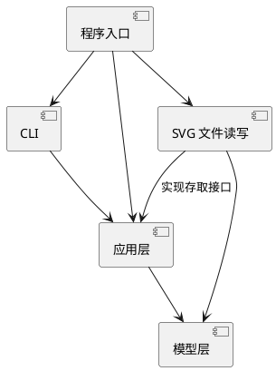

# SVG 编辑器 Phase 1：设计与过程记录

> 本文从第一轮设计开始记录。当前是实施前的方案；实现结果与验证结论将在后续迭代中如实补充。

## 架构方案

### 模块划分

| 目录 | 职责 |
| --- | --- |
| `src/model/` | SVG 文档、图形类与容器树；维护唯一 id、父子关系及图形自身的移动、缩放、属性修改行为。 |
| `src/application/` | 编辑命令、执行与 undo/redo 历史；协调模型操作，并定义 SVG 存取所需的接口。 |
| `src/cli/` | REPL、带引号的参数解析、命令名分发和文字反馈；不直接修改图形内部状态。 |
| `src/infrastructure/` | SVG/XML 与模型的双向转换、文件读写；实现应用层定义的存取接口。 |
| `src/main.ts` | 创建并连接上述对象，启动 CLI。 |

组件图的 PlantUML 源码如下。图中的箭头表示编译时依赖；运行时应用层通过接口调用基础设施实现。

### 设计模式的选择

- **Command（题目要求）**：每个成功的图形编辑操作是一个命令对象，负责执行并保存撤销所需的信息；执行器维护 undo/redo 栈。一条命令对应一个撤销单元，失败命令不入栈。删除、分组和层级调整需要保存原父容器与原位置，不能只保存图形 id。
- **Composite 语义**：叶子图形与 `<g>` 容器共享图形抽象。容器把移动、缩放等操作应用到子孙；调用方不按图形类型重复写分支。模型的公开行为由对象自身负责，避免公共数据袋。
- 本阶段暂不建立通用插件框架。题目中的 `box` 是后续阶段目标，Phase 1 的内置类型只有 `rect`、`circle`、`ellipse`、`line`、`text`、`g`。

### 依赖方向规则

1. `model` 不依赖 CLI、文件系统或应用层；图形行为可以脱离终端测试。
2. `application` 依赖 `model`，通过自己定义的存取接口访问 SVG 文件；不直接依赖具体 XML 库或 Node 文件 API。
3. `cli` 依赖 `application`；`infrastructure` 实现应用层接口并依赖 `model`；只有 `main.ts` 负责装配具体实现。
4. 按名称选择实现只出现在命令分发和图形工厂两处。这两处先集中管理并标为后续重构点，不让 `switch(tag)` 扩散到编辑操作中。

### 变化点假设

| 可能的变化 | 本阶段的处理 |
| --- | --- |
| 新增图形类型 | 图形行为由类封装，类型名到构造器的选择集中在图形工厂；等后续阶段明确插件要求再改为注册机制。 |
| 新增命令或入口 | 编辑动作与 CLI 输入分离；新入口可复用应用层。命令名分发集中在 CLI。 |
| 图形组织方式变化 | 以容器树表达层级，按 id 定位由文档统一负责；不把层级路径写进命令参数。 |
| SVG 读写细节变化 | 限制在 `infrastructure`，模型不直接处理 XML 或文件路径。 |

## 过程记录

### 迭代 1：先明确边界

- 根据题目和课程课件，先将 CLI、命令执行、图形模型、SVG 读写分开，并确定 Command 与 Composite 的落点。
- 选择保存每条命令需要的旧值、原父容器和原位置，以支持精确撤销；暂不为后续 `box` 实现插件框架，避免在需求明确前增加复杂度。
- 此时尚未编写功能代码，以上为待验证的设计假设。后续提交会记录发现的问题和修订。

### 迭代 2：建立可运行的 CLI 骨架

- 建立 TypeScript 编译配置、项目脚本和 CLI 入口。CLI 目前只负责逐行读取、显示提示符、忽略空行与注释；图形模型和命令执行尚未开始实现。
- 输入输出通过构造参数传给 `Cli`，后续可以在不启动真实终端的情况下检查命令行为。此时不提前加入 XML 或插件依赖。
- 已运行 `npm run check`、`npm run build`，并用多行输入验证入口可启动、注释可忽略。尚未实现的命令会明确报错，不将骨架当作完成功能。

## 一致性自查

实现完成后检查：实际目录是否与方案一致；如有调整，记录原因。抽查导入关系是否遵守上面的依赖方向。

## 质量保证手段

计划按题目命令表逐项验证正常流程、非法输入不改变状态、undo/redo 恢复原顺序，以及保存后读回的结构与属性。每轮实现后运行相应的自动化测试；此处不预填尚未得到的测试结果。
