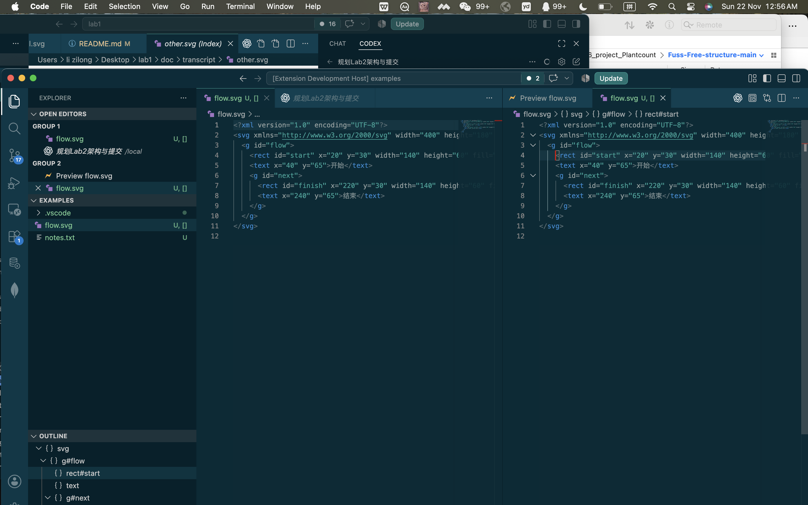

# SVG 文件标记与大纲

## 启动

在仓库根目录运行 `npm ci` 和 `npm run build:extension`，用 VS Code 打开仓库，按 F5 并选择 **SVG Outline Lab**。新打开的 Extension Development Host 会加载本目录的扩展，并打开 `vscode-extension/examples`。该示例工作区把 `.svg` 关联到文本编辑器。打开 `flow.svg`，在 Explorer 查看文件右侧的 `[]`，在 Outline 查看 SVG 层级。点击 `rect#start` 应定位到对应的开始标签；把 `id="start"` 改为 `id="begin"` 后，大纲应更新。编辑过程中暂时删去 `</svg>`，大纲可以清空，补回后恢复。

`[]` 是 Explorer 的装饰标记，不写入 URI、文件名或 SVG 内容。非 `.svg` 文件、目录和读取状态失败的资源不显示标记。扩展只在本地文件的 `.svg` 文本上提供文档符号；SVG 预览窗口本身不是文本编辑器，不显示 Outline。

可在仓库根目录运行 `npm test`，其中 `test/vscode-extension.test.mjs` 检查嵌套结构、无 id 节点、源码位置、编辑后的更新、不完整 XML，以及文件与目录的标记条件。`npm run check:extension` 单独检查扩展的 TypeScript 类型。

## VS Code 与扩展的职责

`activate` 向 VS Code 注册 `FileDecorationProvider` 和 `DocumentSymbolProvider`，并把注销句柄交给扩展上下文。VS Code 在 Explorer 需要绘制资源时调用文件装饰提供者，在文本编辑器需要文档符号时调用符号提供者。Explorer 的排版、Outline 的树控件、点击后的定位以及文档变化后的重新请求由 VS Code 负责。扩展负责判断文件类型、解析当前文本、生成符号层级和源码范围。两项功能通过注册对象接入宿主，不修改 VS Code 的内置代码。

## 模式分析

文件标记使用了可选的界面附加信息，具有“给已有显示增加职责”的装饰意图，但它不是经典 GoF Decorator 的完整结构：扩展没有持有并包装一个实现相同接口的文件对象，`provideFileDecoration` 只是把元数据返回给宿主，实际组合和绘制由 VS Code 完成。`FileDecorationProvider` 是宿主定义的回调接口，不是把另一个文件 API 转换为它的适配器。

大纲部分存在明确的适配：`SvgOutlineParser` 产出与编辑器无关的节点和字符偏移；`SvgDocumentSymbolProvider` 把它们转成 VS Code 的 `DocumentSymbol`、`Range` 和 `SymbolKind`。客户端是 VS Code 原生 Outline，目标接口是 `DocumentSymbolProvider`，被适配的是解析结果。解析与界面协议分开后，XML 结构测试不需要启动 VS Code。

## Phase 1 代码复用

- 复用已依赖的 `saxes` XML 解析库及对 XML 实体、嵌套结构的处理经验。没有另写按 `<` 切割的解析器。
- 不直接复用 `SvgCodec.parse`：它只接受 CLI 模型能无损表达的六种元素和属性，并要求完整的可编辑 SVG；Outline 要反映文本中其他合法 SVG 元素，并允许编辑中的不完整 XML 暂时返回空列表。
- 不复用 `SvgDocument` 与 `Group` 遍历：Outline 展示源文本的元素层级和准确位置，CLI 领域模型不保存源代码范围。为此单独使用轻量的解析节点树，避免把编辑器位置信息塞进图形模型。

## 界面验收记录

自动化测试覆盖提供者的注册对象行为及符号范围。下图在 VS Code 1.130.0 的 Extension Development Host 中取得。Explorer 中 `flow.svg` 右侧显示 `[]`，`notes.txt` 没有标记；Outline 展示嵌套层级，选中 `rect#start` 后源码定位到第 4 行。

